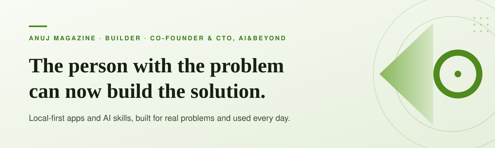

  <picture>
    
  </picture>

# Anuj Magazine

I'm co-founder and CTO at [AI&Beyond](https://aiandbeyond.ai), where we help organizations transform with AI through AI-native services.

This profile is something else. It is my experimentation ground: the place where I build with AI myself, on my own problems, and learn the things no strategy deck can teach.

 

  <picture>
    
  </picture>
   
  My GitHub activity over the last year

 

## The shift

For most of the history of software, if nothing existed for your problem, you had two choices. Wait for someone to build it, or live with it.

That is no longer true. With AI, the person who feels the problem can build the fix, often in an evening, often without being a professional developer.

> **The bottleneck has moved from building to noticing.**
> Building is getting cheaper every month. Seeing a problem clearly enough to solve it is now the scarce skill.

 

## How to spot a problem worth building for

Most people don't lack ideas. They have trained themselves not to see them. These are the habits I use to see them again.

1. **Never ignore a pain point.** The moment you shrug and adapt, the problem becomes invisible. Annoyance is data. Write it down before it fades.

2. **Never think it is too small.** Small problems are the ones nobody else will solve for you, and the ones you will actually finish. Big things are usually many small fixes in a row.

3. **Never assume someone has already solved it.** Even if they have, they solved the average version. Yours has your files, your workflow, your quirks. That gap is your app.

4. **Follow your workarounds.** Every sticky note, side spreadsheet, repeated copy-paste and "I'll just do it manually" is software that doesn't exist yet.

5. **Count to three.** Do something once, it is a task. Twice, a coincidence. The third time, it is a pattern, and patterns are worth building for.

6. **Notice what you avoid.** The work you keep postponing often hides a broken process, not a lack of discipline.

7. **Keep a complaint list for one week.** Every time you sigh, groan or say "why is this so hard", note it. At the end of the week, you will have a roadmap.

8. **Ask what you would pay to never do it again.** If the honest answer is "a lot", stop paying in time and attention. Build the fix.

 

## How I build

1. **Problem first, technology second.** I don't ask "what can I build with AI?" I ask "what keeps getting in my way?" The second question produces things people actually use.

2. **Local first.** Most of what I build runs on your own machine, works offline where it can, needs no account, and keeps your data with you. Trust is what turns a clever demo into a daily habit.

3. **Smallest fix that removes the pain today.** Ugly and working beats beautiful and planned. Polish comes after the tool has earned its place.

4. **Use it before sharing it.** Daily use is the only honest test. It reveals everything a demo hides.

5. **Share it with someone who has the same problem.** Their first five minutes with it will teach me more than a month on my own.

6. **Be honest about the AI.** AI gets you to a working first version remarkably fast. Making it reliable, safe and genuinely useful is still human work. I say what it did well, what it got wrong, and what it cannot do.

7. **Let experiments die.** Not every build needs to become a product. Knowing when to stop is as important as knowing what to start.

 

## What building teaches that reading can't

- **You only learn AI's limits by hitting them.** Articles tell you what AI can do. Building shows you exactly where it breaks.
- **Clear thinking is the new code.** If you can describe a problem precisely, AI can usually help you build the solution. Most failures are unclear problems, not weak models.
- **Once you fix one annoyance, you start seeing them everywhere.** That shift in how you look at your own work is the real outcome. The app is a side effect.
- **This is what transformation looks like on the ground.** Every organization is full of small, unspoken pain points. When people learn to notice and fix their own, change stops being a programme and becomes a habit.

 

## What you'll find here

Apps and AI skills built this way: real problems, local first, used before shared. Some are polished. Some are rough experiments. I'll say plainly which is which.

This space is always being built, and new things arrive as they earn their place.

**Start with any [repository](https://github.com/anujmagazine?tab=repositories).** Each one began as an annoyance. See if it is yours too. If something doesn't work for you, open an issue. If you have a problem you wish someone would solve, tell me.

 

## Your turn

Pick one thing that annoyed you this week. Describe it in three sentences, as if to a friend. Then build the smallest thing that makes it go away.

You may be surprised how far one evening gets you.

[LinkedIn](https://www.linkedin.com/in/anujmagazine/) · [AI&Beyond](https://aiandbeyond.ai)

 

*The interesting question about AI is no longer what it can build. It is who gets to build now.*
